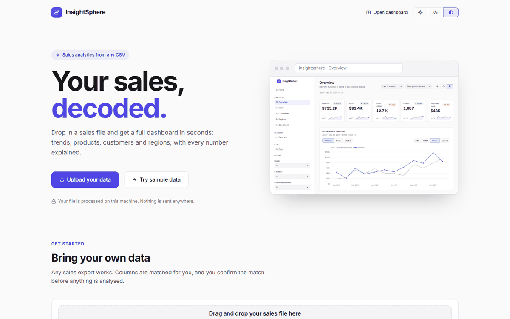
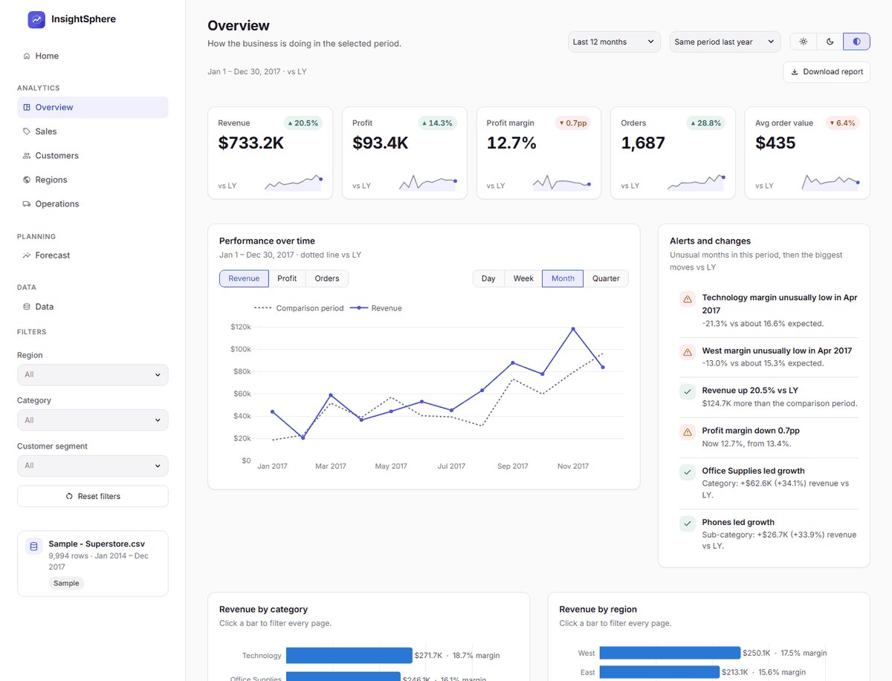
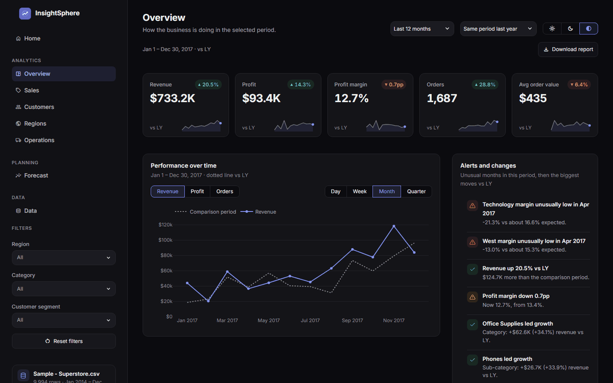
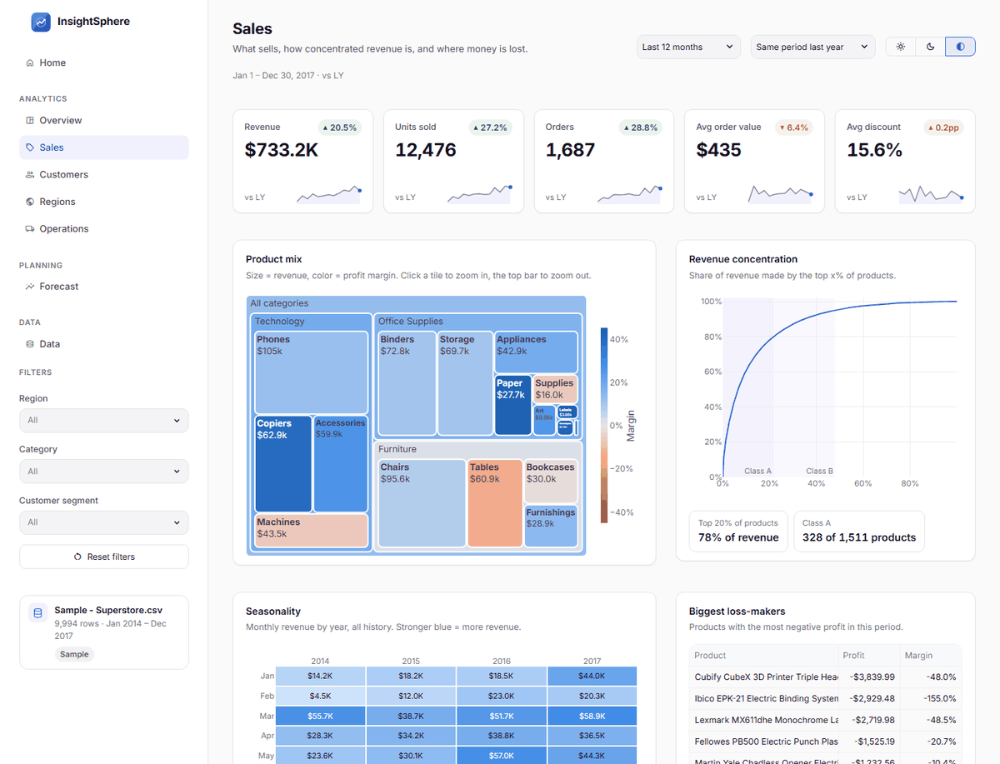
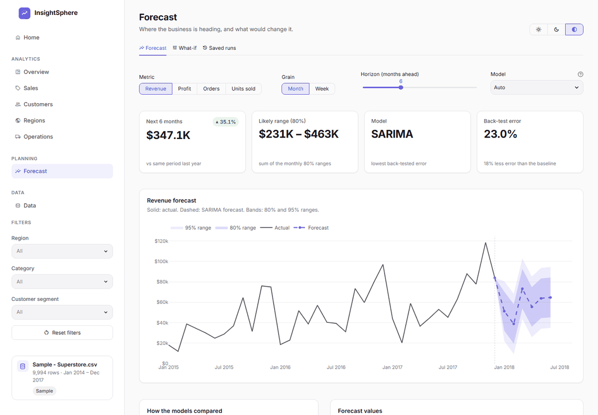
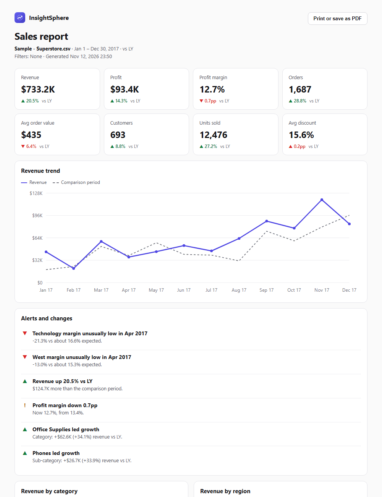

# InsightSphere

**Your sales, decoded.** Upload any sales export (CSV or Excel) and get a full business dashboard: KPIs against last year, product and customer analysis, a map of regions, discount and shipping insights, back-tested forecasts, anomaly alerts, a what-if simulator and a one-click report.

Built with Streamlit, pandas, Plotly and statsmodels. Everything runs on your own machine: your data is never uploaded anywhere.



---

## What's inside

| Page | What it answers |
|---|---|
| **Home** | What the app does; upload a file and confirm how its columns map. |
| **Overview** | Headline KPIs with change vs last year (or the previous period) and 12-month sparklines, the revenue trend against the comparison period, **alerts** for unusual months, the biggest changes, revenue by category and region, top movers, and **Download report**. |
| **Sales** | Product mix (treemap colored by margin), revenue concentration (Pareto and ABC classes), seasonality heatmap, loss-making products, searchable product table with 12-month trends. |
| **Customers** | RFM segments (Champions, At risk, ...), retention by cohort, new vs returning revenue, top customers. |
| **Regions** | Region tiles, US state map (revenue or margin), state ranking, region / state / city breakdown, state explorer. |
| **Operations** | Margin and loss-making share by discount band, discount vs margin by sub-category, ship modes, ship-time trend and distribution. |
| **Forecast** | Forecast with 80% and 95% ranges, model comparison from back-tests, a **what-if** simulator (discount, price, volume) and **saved runs** you can compare. |
| **Data** | Data-health checks, the column mapping, a searchable data explorer with CSV/Excel export, and monthly revenue targets. |

Clicking a bar on the Overview filters every page; filters show as removable chips. Light and dark themes switch instantly from the top of every page.



<details>
<summary>More screenshots</summary>

**Overview, dark theme**


**Sales**


**Forecast**


**Downloadable report** (HTML, prints to PDF)


</details>

---

## Run it

Requires Python 3.12 or newer.

```bash
pip install -r requirements.txt
python -m streamlit run app.py
```

The app opens in your browser at http://localhost:8501. It starts empty: upload a file on the Home page, or press **Try sample data** to explore with the bundled Superstore dataset.

To run the tests:

```bash
pip install -r requirements-dev.txt
python -m pytest
```

---

## Using your own data

One row per order line, as a `.csv`, `.xlsx` or `.xls` file. Only two columns are required:

| Field | Required | Examples of column names that are recognised |
|---|---|---|
| Order date | yes | Order Date, Invoice Date, Date of Sale, Transaction Date |
| Revenue | yes | Sales, Revenue, Net Sales, Amount, Total |
| Order ID, customer, product, category, sub-category, region, state, city, segment, quantity, discount, profit or cost, ship date, ship mode | no | Invoice No, Cust, Client ID, Item, Department, Country, Territory, Qty, Gross Profit, ... |

Columns are matched automatically and you confirm the match before anything is analysed. Every optional column unlocks more: customers unlock the Customers page, a state column unlocks the map, discount and profit unlock the what-if simulator, and so on. Pages that need a missing column say which one.

Cleaning is careful rather than clever:

- Currency symbols and thousands separators are removed (`€1,069.42`, `$1,234.50`).
- Day-first or month-first dates are detected from the whole column, not guessed from the first row.
- Blank rows and exact duplicates are removed and counted.
- Text labels are normalised (`west`, `West ` → `West`).
- **Missing numbers are left missing, never filled in.** Rows without a date or revenue are skipped and counted.
- Profit is derived as revenue − cost when only cost is given; a discount of `20` is read as 20%.

The Data page shows exactly what was changed.

---

## How the numbers are made

**Comparisons.** Date ranges are anchored to the last order in the data, so "Last 12 months" means the data's last 12 months. A comparison is only shown when the comparison period is fully covered by data, so growth can't be inflated by half-empty periods.

**Forecasts.** Three models are compared on every run:

- seasonal naive (same period last year), the baseline to beat;
- exponential smoothing with a damped trend and seasonality;
- SARIMA(1,1,1)(0,1,1,12).

Each model is scored with a rolling-origin back-test: it forecasts from several past points using only the data before each point. *Auto* picks the lowest MASE (error relative to the baseline). On the Superstore sample the chosen model has about 18% less error than the baseline. The incomplete last period is left out, and with under two years of history seasonality is switched off.

**Alerts.** Each month is compared with what was expected from the months before it: same month last year × recent growth for revenue, trailing median for margin. A month is flagged when it's more than 3.5 robust z-scores from normal. Slices with too few orders a month are skipped, so one large order can't raise a false alarm.

**What-if.** The discount effect comes from how margin moved with discount across your order lines in the last 12 months (a revenue-weighted regression per category). It's an observed pattern, not proof of cause and effect, and it assumes volume stays the same. Price and volume changes are plain arithmetic. Results show a likely range.

---

## Project structure

```
app.py               entry point: navigation, theme, sidebar
core/                data and analysis (pure pandas, unit-tested)
  schema.py          canonical fields, column-name matching
  cleaning.py        safe cleaning: types, dates, blanks, duplicates
  ingest.py          read, map, derive, save uploads
  filters.py         date windows, comparisons, dimension filters
  metrics.py         KPIs, series, breakdowns, top movers
  insights.py        plain-language highlights
  anomalies.py       unusual-month detection
  forecasting.py     models, back-tests, intervals
  simulator.py       what-if levers
  analytics/         customers (RFM, cohorts), products (Pareto, ABC), operations
  db.py              SQLite: revenue targets, saved forecast runs
ui/                  design system: tokens, theme CSS, components, charts, report
views/               one file per page
static/              landing-page hero images
tests/               pytest suite (unit tests + every page rendered with four kinds of upload)
```

## Tech stack

Streamlit 1.59 · pandas 3 · NumPy 2 · Plotly 6 · statsmodels 0.15 · SQLite · pytest
